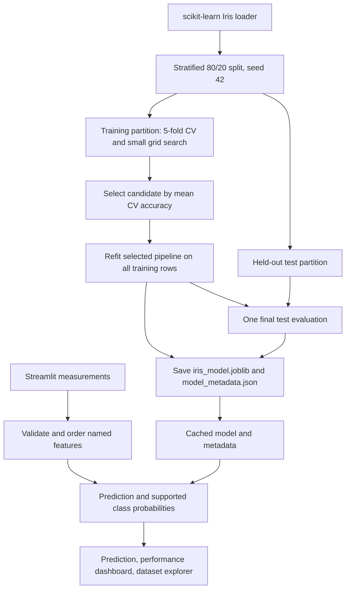

# Iris Species Predictor

A small, reproducible multiclass classification project and Streamlit demonstration. It predicts one of the three Iris species in scikit-learn's bundled Iris dataset from four flower measurements. **It is not a general-purpose plant species identifier.**

## Dataset and scope

The immediate data source is `sklearn.datasets.load_iris`, which ships with scikit-learn. The repository does not download a CSV or document a separate original-source URL. The loaded dataset has 150 rows, four numeric measurements in centimetres, and three integer-encoded labels mapped to `setosa`, `versicolor`, and `virginica`:

| Feature | Unit |
| --- | --- |
| sepal length | cm |
| sepal width | cm |
| petal length | cm |
| petal width | cm |

There are 50 examples per class. The project uses the small, curated Iris dataset; its results do not establish performance on other plants, field observations, or shifted measurement conditions.

## Architecture



Implementation is split across `src/data.py` (loading and splitting), `src/train.py` (candidate search, evaluation, persistence), `src/predict.py` (validation and artifact loading), and `app.py` (Streamlit presentation). The fitted model is a scikit-learn `Pipeline`; the Streamlit app does not retrain it when widgets change.

## Training and evaluation

Training reserves 20% of the data as a stratified test partition using `random_state=42`. The remaining 120 rows (40 per class) are used for selection. Seven candidate configurations are compared: a most-frequent `DummyClassifier` baseline, Logistic Regression, SVC, K-Nearest Neighbors, Decision Tree, Random Forest, and Extra Trees. A five-fold `StratifiedKFold` with shuffling and seed 42 is used inside `GridSearchCV`. Scaling is inside the pipelines for Logistic Regression, SVC, and KNN; tree models and the dummy baseline are not scaled. The test partition is not used for selection or tuning.

Mean CV accuracy is the primary selection metric; mean macro-F1 and then the fixed candidate order break ties. A small grid is searched for each non-baseline candidate. The selected pipeline is refit on the full training partition. Training-fold permutation importance is calculated using the same training partition's validation folds; it does not use the final test partition.

### Results from the training run in this workspace

These are measured by `python -m src.train` with Python 3.14.7, scikit-learn 1.8.0, pandas 3.0.3, and NumPy 2.4.5. The fixed test partition contains 30 rows (10 per class). These figures are one small held-out split, not a universal performance guarantee.

| Candidate (best grid setting) | 5-fold training CV accuracy, mean ± std |
| --- | ---: |
| Dummy (most frequent) | 0.333 ± 0.000 |
| Logistic Regression | 0.967 ± 0.031 |
| Support Vector Classifier | **0.975 ± 0.020** |
| K-Nearest Neighbors | 0.967 ± 0.017 |
| Decision Tree | 0.958 ± 0.026 |
| Random Forest | 0.967 ± 0.031 |
| Extra Trees | 0.958 ± 0.026 |

The selected model is a `StandardScaler` + linear SVC pipeline with `C=0.1`, chosen using training-fold CV. Its final held-out test results are:

| Metric | Held-out value |
| --- | ---: |
| Accuracy | 0.933 (28/30 correct) |
| Macro precision | 0.933 |
| Macro recall | 0.933 |
| Macro-F1 | 0.933 |
| Weighted-F1 | 0.933 |

| Actual / predicted | setosa | versicolor | virginica |
| --- | ---: | ---: | ---: |
| setosa | 10 | 0 | 0 |
| versicolor | 0 | 9 | 1 |
| virginica | 0 | 1 | 9 |

Per-class test precision, recall, and F1 are all 1.00 for setosa, and 0.90 for both versicolor and virginica (support 10 each). The earlier 96% claim is not reproduced by the committed evaluation procedure and should not be repeated as this project's held-out result. The current recorded result is 93.3% on this specific fixed split.

The dashboard also shows mean CV accuracy/F1 with fold standard deviations and global permutation importance. Importance is a non-causal global ranking, not an explanation for an individual prediction. The test partition has only 30 samples, so one prediction changes accuracy by 3.3 percentage points; more independent data would be needed for a stronger generalization claim.

## Setup and local use

The checked-in `requirements.txt` pins the five direct runtime dependencies. The current environment was verified on Python 3.14.7; Python is not pinned in the repository. The source uses Python 3.10+ type syntax.

```bash
python -m venv .venv
source .venv/bin/activate
python -m pip install -r requirements.txt
python -m src.train
python -m unittest discover -s tests -v
streamlit run app.py
```

Training writes `artifacts/iris_model.joblib` and `artifacts/model_metadata.json`. The joblib file contains the fitted pipeline; the JSON records the dataset schema and counts, split indices and seed, CV comparisons and selected parameters, final metrics, permutation importance, and runtime versions. The UI loads these artifacts and provides a clear message with the training command if they are missing or incompatible. Only load model artifacts produced by a trusted source because joblib uses pickle internally.

To retrain with the documented defaults, run `python -m src.train`. Optional flags include `--seed`, `--test-size`, and `--output-dir`; changing the seed or test size creates a different experimental split and therefore different measured results. The app cache key uses each artifact's modification time and size, so replacing the files refreshes the loaded bundle on the next rerun. If you change the artifact directory, update the app's configured artifact paths before launch.

## Reading predictions

Inputs are validated as finite numeric values and reordered by feature name to match the fitted pipeline. Values outside the training partition's per-feature min/max are allowed but trigger a warning. This is a simple extrapolation heuristic: a value inside every univariate range can still be unusual in combination, and the warning is not an out-of-distribution detector. The chosen SVC exposes probability estimates, which the UI displays as model-estimated probabilities. They have not been independently calibrated or validated as real-world certainty.

The dataset explorer uses the loaded Iris data to display class counts, selectable feature scatter plots, and binned feature distributions. The performance dashboard clearly separates training-fold CV scores from final held-out test metrics.

## Limitations and deployment

- This predicts only the three Iris labels from four specified measurements.
- The final test estimate is from one 30-row split of a small, well-known dataset; no external validation is included.
- Class probabilities are not separately calibrated, and the range warning is only a heuristic.
- The app requires a previously trained compatible artifact; it intentionally does not train on page loads or widget reruns.
- No cloud deployment configuration has been added or verified. The supported instructions here are for local use.

Potential next steps include collecting representative external data, validating calibration and uncertainty, assessing distribution shift, and tracking repeated split or nested-CV results before making broader performance claims.
